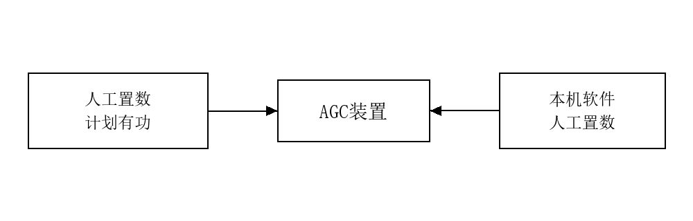

# 兴安盟 AGC 系统出厂试验报告

| 项目 | 内容 |
|:---|:---|
| 试验日期 | 2026 年 11 月 2 日 |
| 参加人员 | 李浩 |
| 记录整理 | 李浩 |
| 审　　核 | 张群 |

**沈阳天河自动化工程有限公司**

**2026 年 11 月 2 日**

---

## 目的

出厂前试验是为了对产品的功能进行全面、严格的测试，试验项目必须全部合格方可出厂。

试验项目安排的根据是：

1. GB/T13729—1992 远动终端通用技术条件
2. 产品出厂验收标准
3. 发电厂有功功率控制系统（AGC）

系统出厂测试大纲

沈阳天河自动化工程有限公司 编

---

## 试验项目

### 1. 绝缘电阻

凡与二次设备（如接入 CT、PT 的回路）及外部回路（如电源回路、遥信输出回路等）相连接的电路均需做绝缘电阻测试，兆欧表手柄转动速度 120 转/分，试验时间不小于 1 分钟。试验时，兆欧表红色表笔接被试回路、黑色表笔接 AGC 装置柜体的接地镙栓。

如外部电路工作电压 ≥60 伏，AGC 装置与这部份外部回路相连接的电路的绝缘电阻就用 500 伏兆欧表检验。

#### 机柜绝缘电阻测试

> 电源回路绝缘电阻检验

500V 兆欧表型号：ZC-7　编号：02050266

| 序号 | 接线端子 | 回路名 | 实测绝缘电阻值（MΩ） | 合格值（MΩ） |
| :---: | :---: | :---: | :---: | :---: |
| 1 | VL | 电源回路 | ≥2 MΩ | 湿度大的情况下 ≥1 MΩ |
| 2 | VN | 电源回路 |        ≥2 MΩ         | 湿度大的情况下 ≥1 MΩ |

### 2. 绝缘强度试验（在不做介质强度试验的情况下必须进行本项试验）

> 根据习惯做法，绝缘强度试验可用 2500 伏的兆欧姆表测得的绝缘电阻来替代。

2500V 兆欧表型号：ZC-7　编号：03070178

| 序号 | 接线端子 | 回路名 | 实测绝缘电阻值（MΩ） | 合格值（MΩ） |
| :---: | :---: | :---: | :---: | :---: |
| 1 | VL | 电源回路 |        ≥2 MΩ         | 湿度大的情况下 ≥1 MΩ |
| 2 | VN | 电源回路 |        ≥2 MΩ         | 湿度大的情况下 ≥1 MΩ |

### 3. AGC 调节限制条件试验

试验时采用本机软件人工置数作为有功指令、CT、PT 的给定源，试验线路如下图：

*图 1　AGC 装置试验线路示意图*

按照调度“本工程发电机组所发电量自发自用、余量不上网”的要求，AGC 装置以并网点有功值为 0 作为控制目标。试验中人工置数为 66kV 母线有功给定值 0，AGC 装置根据优化等算法，成组分配各机组有功功率后，便向测控装置发出目标有功功率的遥调命令，确保并网点的有功值为 0；并用本机人工置数模拟发电机有功功率 P 增减状况，发电机有功功率 P 的变化是靠 AGC 装置下发的有功给定值来实现的。

#### 1) 在下列限制条件成立时，AGC 装置应停止调节

试验中通过人工模拟各闭锁信号，验证 AGC 装置的闭锁行为。

1. **机组调整无效时闭锁对应机组**

   在调整过程中，如果机组在调节时间内没有达到调整目标，则判断为调整无效，将在下一个调整周期中闭锁该机组调节。

   结论：合格

2. **通信故障闭锁**

   当 AGC 跟 NCS、测控装置任一设备通信出现问题，将闭锁 AGC 调整。

   结论：合格

3. **数据错误闭锁**

   当 AGC 调整时，重要数据在一定时间内不变，即报数据错误闭锁，将闭锁 AGC 调整。

   结论：合格

4. **机组检修闭锁**

   当 AGC 调整时，机组检修信号报出来，将闭锁该机组。

   结论：合格

5. **机组 RB 闭锁**

   当 AGC 调整时，机组 RB 信号报出来，将闭锁该机组。

   结论：合格

6. **机组并网闭锁**

   当 AGC 调整时，机组并网信号分开，将闭锁该机组。

   结论：合格

7. **机组保护闭锁**

   当 AGC 调整时，机组保护信号报出来，将闭锁该机组。

   结论：合格

8. **机组有功上限闭锁**

   当 AGC 调整时，机组有功功率超过有功上限，将闭锁该机组。

   结论：合格

9. **机组有功下限闭锁**

   当 AGC 调整时，机组有功功率低于有功下限，将闭锁该机组。

   结论：合格

10. **机组 AGC 投退闭锁**

    当 AGC 调整时，机组 AGC 投退信号退出，将闭锁该机组。

    结论：合格

#### 2) 双机冗余试验

为保证系统投入运行后安全性和可靠性，AGC 装置设计成了双主机通过以太网来实现冗余。其中一台主机作为执行者来完成所有功能任务，另一台备机实时监控主机工作状态，如果主机出现故障，则备机自动升级为主机接替执行者任务。

##### 1. 调整间歇切换实验

| 状态 | 结论 | 切换时间 |
| :---: | :---: | :---: |
| 主机退出 | 备机成功升为主机 | 1s |
| 原主机投入运行，处于备机状态 | 原备机仍然为主机状态。 |  |

##### 2. 调整过程中切换实验

| 状态 | 结论 | 切换时间 |
| :---: | :---: | :---: |
| 拔掉主机通信线 | 备机成功升为主机，并沿续原主机调整量，继续调整直到进入死区 | 1s |
| 恢复原主机通信线 | 原主机成为备机工作状态 |  |

##### 3. 报警过程中切换实验

| 状态 | 结论 | 切换时间 |
| :---: | :---: | :---: |
| 拔掉主机通信线 | 备机成功升为主机，同时获取到报警状态 | 1s |
| 恢复原主机通信线 | 原主机成为备机工作状态 |  |

#### 3) Watchdog 看门狗

将 AGC 装置主机程序，通过命令结束进程，Watchdog 软件在设定的时间内，原 AGC 装置主机自动重新启动程序。

### 4. AGC 装置输入输出信号量测试

#### 1. 开关量输入（DI）测试

1# 机组：

| 序号 | 遥信 | 次数 | 模拟源 | AGC 侧 | 测试结果 | 备注 |
| :---: | :---: | :---: | :---: | :---: | :---: | :---: |
| 1 | 1#机组AGC开关锁（1：闭锁；0：解锁） | 1 | 1：闭锁 | 1：闭锁 | ✔合格 □不合格 | |
| 1 | 1#机组AGC开关锁（1：闭锁；0：解锁） | 2 | 0：解锁 | 0：解锁 | ✔合格 □不合格 | |
| 2 | 1#机组一次调频投入退出（1：投入；0：退出） | 1 | 1：投入 | 1：投入 | ✔合格 □不合格 | |
| 2 | 1#机组一次调频投入退出（1：投入；0：退出） | 2 | 0：退出 | 0：退出 | ✔合格 □不合格 | |
| 3 | 1#机组并网状态（1：并网；0：解列） | 1 | 1：并网 | 1：并网 | ✔合格 □不合格 | |
| 3 | 1#机组并网状态（1：并网；0：解列） | 2 | 0：解列 | 0：解列 | ✔合格 □不合格 | |
| 4 | 1#机组RB动作（1：动作；0：复归） | 1 | 1：动作 | 1：动作 | ✔合格 □不合格 | |
| 4 | 1#机组RB动作（1：动作；0：复归） | 2 | 0：复归 | 0：复归 | ✔合格 □不合格 | |
| 5 | 1#机组保护动作（1：动作；0：复归） | 1 | 1：动作 | 1：动作 | ✔合格 □不合格 | |
| 5 | 1#机组保护动作（1：动作；0：复归） | 2 | 0：复归 | 0：复归 | ✔合格 □不合格 | |

2# 机组：

| 序号 | 遥信 | 次数 | 模拟源 | AGC 侧 | 测试结果 | 备注 |
| :---: | :---: | :---: | :---: | :---: | :---: | :---: |
| 1 | 2#机组AGC开关锁（1：闭锁；0：解锁） | 1 | 1：闭锁 | 1：闭锁 | ✔合格 □不合格 | |
| 1 | 2#机组AGC开关锁（1：闭锁；0：解锁） | 2 | 0：解锁 | 0：解锁 | ✔合格 □不合格 | |
| 2 | 2#机组一次调频投入退出（1：投入；0：退出） | 1 | 1：投入 | 1：投入 | ✔合格 □不合格 | |
| 2 | 2#机组一次调频投入退出（1：投入；0：退出） | 2 | 0：退出 | 0：退出 | ✔合格 □不合格 | |
| 3 | 2#机组并网状态（1：并网；0：解列） | 1 | 1：并网 | 1：并网 | ✔合格 □不合格 | |
| 3 | 2#机组并网状态（1：并网；0：解列） | 2 | 0：解列 | 0：解列 | ✔合格 □不合格 | |
| 4 | 2#机组RB动作（1：动作；0：复归） | 1 | 1：动作 | 1：动作 | ✔合格 □不合格 | |
| 4 | 2#机组RB动作（1：动作；0：复归） | 2 | 0：复归 | 0：复归 | ✔合格 □不合格 | |
| 5 | 2#机组保护动作（1：动作；0：复归） | 1 | 1：动作 | 1：动作 | ✔合格 □不合格 | |
| 5 | 2#机组保护动作（1：动作；0：复归） | 2 | 0：复归 | 0：复归 | ✔合格 □不合格 | |

3# 机组：

| 序号 | 遥信 | 次数 | 模拟源 | AGC 侧 | 测试结果 | 备注 |
| :---: | :---: | :---: | :---: | :---: | :---: | :---: |
| 1 | 3#机组AGC开关锁（1：闭锁；0：解锁） | 1 | 1：闭锁 | 1：闭锁 | ✔合格 □不合格 | |
| 1 | 3#机组AGC开关锁（1：闭锁；0：解锁） | 2 | 0：解锁 | 0：解锁 | ✔合格 □不合格 | |
| 2 | 3#机组一次调频投入退出（1：投入；0：退出） | 1 | 1：投入 | 1：投入 | ✔合格 □不合格 | |
| 2 | 3#机组一次调频投入退出（1：投入；0：退出） | 2 | 0：退出 | 0：退出 | ✔合格 □不合格 | |
| 3 | 3#机组并网状态（1：并网；0：解列） | 1 | 1：并网 | 1：并网 | ✔合格 □不合格 | |
| 3 | 3#机组并网状态（1：并网；0：解列） | 2 | 0：解列 | 0：解列 | ✔合格 □不合格 | |
| 4 | 3#机组RB动作（1：动作；0：复归） | 1 | 1：动作 | 1：动作 | ✔合格 □不合格 | |
| 4 | 3#机组RB动作（1：动作；0：复归） | 2 | 0：复归 | 0：复归 | ✔合格 □不合格 | |
| 5 | 3#机组保护动作（1：动作；0：复归） | 1 | 1：动作 | 1：动作 | ✔合格 □不合格 | |
| 5 | 3#机组保护动作（1：动作；0：复归） | 2 | 0：复归 | 0：复归 | ✔合格 □不合格 | |

4# 机组：

| 序号 | 遥信 | 次数 | 模拟源 | AGC 侧 | 测试结果 | 备注 |
| :---: | :---: | :---: | :---: | :---: | :---: | :---: |
| 1 | 4#机组AGC开关锁（1：闭锁；0：解锁） | 1 | 1：闭锁 | 1：闭锁 | ✔合格 □不合格 | |
| 1 | 4#机组AGC开关锁（1：闭锁；0：解锁） | 2 | 0：解锁 | 0：解锁 | ✔合格 □不合格 | |
| 2 | 4#机组一次调频投入退出（1：投入；0：退出） | 1 | 1：投入 | 1：投入 | ✔合格 □不合格 | |
| 2 | 4#机组一次调频投入退出（1：投入；0：退出） | 2 | 0：退出 | 0：退出 | ✔合格 □不合格 | |
| 3 | 4#机组并网状态（1：并网；0：解列） | 1 | 1：并网 | 1：并网 | ✔合格 □不合格 | |
| 3 | 4#机组并网状态（1：并网；0：解列） | 2 | 0：解列 | 0：解列 | ✔合格 □不合格 | |
| 4 | 4#机组RB动作（1：动作；0：复归） | 1 | 1：动作 | 1：动作 | ✔合格 □不合格 | |
| 4 | 4#机组RB动作（1：动作；0：复归） | 2 | 0：复归 | 0：复归 | ✔合格 □不合格 | |
| 5 | 4#机组保护动作（1：动作；0：复归） | 1 | 1：动作 | 1：动作 | ✔合格 □不合格 | |
| 5 | 4#机组保护动作（1：动作；0：复归） | 2 | 0：复归 | 0：复归 | ✔合格 □不合格 | |

#### 2. 开关量输出（DO）测试

1# 机组：

| 序号 | 输出信号 | 次数 | AGC 侧置数 | 端子测得 | 测试结果 | 备注 |
| :---: | :---: | :---: | :---: | :---: | :---: | :---: |
| 1 | 1#机远方AGC投入状态（1：投入；0：退出） | 1 | 1：投入 | 1：投入 | ✔合格 □不合格 | |
| 1 | 1#机远方AGC投入状态（1：投入；0：退出） | 2 | 0：退出 | 0：退出 | ✔合格 □不合格 | |
| 2 | 1#机AGC故障信号（1：故障；0：正常） | 1 | 1：故障 | 1：故障 | ✔合格 □不合格 | |
| 2 | 1#机AGC故障信号（1：故障；0：正常） | 2 | 0：正常 | 0：正常 | ✔合格 □不合格 | |
| 3 | 1#机组AGC增闭锁信号（1：闭锁；0：解锁） | 1 | 1：闭锁 | 1：闭锁 | ✔合格 □不合格 | |
| 3 | 1#机组AGC增闭锁信号（1：闭锁；0：解锁） | 2 | 0：解锁 | 0：解锁 | ✔合格 □不合格 | |
| 4 | 1#机组AGC减闭锁信号（1：闭锁；0：解锁） | 1 | 1：闭锁 | 1：闭锁 | ✔合格 □不合格 | |
| 4 | 1#机组AGC减闭锁信号（1：闭锁；0：解锁） | 2 | 0：解锁 | 0：解锁 | ✔合格 □不合格 | |
| 5 | 1#机组超出调节能力（1：越限；0：正常） | 1 | 1：越限 | 1：越限 | ✔合格 □不合格 | |
| 5 | 1#机组超出调节能力（1：越限；0：正常） | 2 | 0：正常 | 0：正常 | ✔合格 □不合格 | |

2# 机组：

| 序号 | 输出信号 | 次数 | AGC 侧置数 | 端子测得 | 测试结果 | 备注 |
| :---: | :---: | :---: | :---: | :---: | :---: | :---: |
| 1 | 2#机远方AGC投入状态（1：投入；0：退出） | 1 | 1：投入 | 1：投入 | ✔合格 □不合格 | |
| 1 | 2#机远方AGC投入状态（1：投入；0：退出） | 2 | 0：退出 | 0：退出 | ✔合格 □不合格 | |
| 2 | 2#机AGC故障信号（1：故障；0：正常） | 1 | 1：故障 | 1：故障 | ✔合格 □不合格 | |
| 2 | 2#机AGC故障信号（1：故障；0：正常） | 2 | 0：正常 | 0：正常 | ✔合格 □不合格 | |
| 3 | 2#机组AGC增闭锁信号（1：闭锁；0：解锁） | 1 | 1：闭锁 | 1：闭锁 | ✔合格 □不合格 | |
| 3 | 2#机组AGC增闭锁信号（1：闭锁；0：解锁） | 2 | 0：解锁 | 0：解锁 | ✔合格 □不合格 | |
| 4 | 2#机组AGC减闭锁信号（1：闭锁；0：解锁） | 1 | 1：闭锁 | 1：闭锁 | ✔合格 □不合格 | |
| 4 | 2#机组AGC减闭锁信号（1：闭锁；0：解锁） | 2 | 0：解锁 | 0：解锁 | ✔合格 □不合格 | |
| 5 | 2#机组超出调节能力（1：越限；0：正常） | 1 | 1：越限 | 1：越限 | ✔合格 □不合格 | |
| 5 | 2#机组超出调节能力（1：越限；0：正常） | 2 | 0：正常 | 0：正常 | ✔合格 □不合格 | |

3# 机组：

| 序号 | 输出信号 | 次数 | AGC 侧置数 | 端子测得 | 测试结果 | 备注 |
| :---: | :---: | :---: | :---: | :---: | :---: | :---: |
| 1 | 3#机远方AGC投入状态（1：投入；0：退出） | 1 | 1：投入 | 1：投入 | ✔合格 □不合格 | |
| 1 | 3#机远方AGC投入状态（1：投入；0：退出） | 2 | 0：退出 | 0：退出 | ✔合格 □不合格 | |
| 2 | 3#机AGC故障信号（1：故障；0：正常） | 1 | 1：故障 | 1：故障 | ✔合格 □不合格 | |
| 2 | 3#机AGC故障信号（1：故障；0：正常） | 2 | 0：正常 | 0：正常 | ✔合格 □不合格 | |
| 3 | 3#机组AGC增闭锁信号（1：闭锁；0：解锁） | 1 | 1：闭锁 | 1：闭锁 | ✔合格 □不合格 | |
| 3 | 3#机组AGC增闭锁信号（1：闭锁；0：解锁） | 2 | 0：解锁 | 0：解锁 | ✔合格 □不合格 | |
| 4 | 3#机组AGC减闭锁信号（1：闭锁；0：解锁） | 1 | 1：闭锁 | 1：闭锁 | ✔合格 □不合格 | |
| 4 | 3#机组AGC减闭锁信号（1：闭锁；0：解锁） | 2 | 0：解锁 | 0：解锁 | ✔合格 □不合格 | |
| 5 | 3#机组超出调节能力（1：越限；0：正常） | 1 | 1：越限 | 1：越限 | ✔合格 □不合格 | |
| 5 | 3#机组超出调节能力（1：越限；0：正常） | 2 | 0：正常 | 0：正常 | ✔合格 □不合格 | |

4# 机组：

| 序号 | 输出信号 | 次数 | AGC 侧置数 | 端子测得 | 测试结果 | 备注 |
| :---: | :---: | :---: | :---: | :---: | :---: | :---: |
| 1 | 4#机远方AGC投入状态（1：投入；0：退出） | 1 | 1：投入 | 1：投入 | ✔合格 □不合格 | |
| 1 | 4#机远方AGC投入状态（1：投入；0：退出） | 2 | 0：退出 | 0：退出 | ✔合格 □不合格 | |
| 2 | 4#机AGC故障信号（1：故障；0：正常） | 1 | 1：故障 | 1：故障 | ✔合格 □不合格 | |
| 2 | 4#机AGC故障信号（1：故障；0：正常） | 2 | 0：正常 | 0：正常 | ✔合格 □不合格 | |
| 3 | 4#机组AGC增闭锁信号（1：闭锁；0：解锁） | 1 | 1：闭锁 | 1：闭锁 | ✔合格 □不合格 | |
| 3 | 4#机组AGC增闭锁信号（1：闭锁；0：解锁） | 2 | 0：解锁 | 0：解锁 | ✔合格 □不合格 | |
| 4 | 4#机组AGC减闭锁信号（1：闭锁；0：解锁） | 1 | 1：闭锁 | 1：闭锁 | ✔合格 □不合格 | |
| 4 | 4#机组AGC减闭锁信号（1：闭锁；0：解锁） | 2 | 0：解锁 | 0：解锁 | ✔合格 □不合格 | |
| 5 | 4#机组超出调节能力（1：越限；0：正常） | 1 | 1：越限 | 1：越限 | ✔合格 □不合格 | |
| 5 | 4#机组超出调节能力（1：越限；0：正常） | 2 | 0：正常 | 0：正常 | ✔合格 □不合格 | |

#### 3. 模拟量测试（4-20mA）

1# 机组：

| 序号 | 信号量 | 次数 | 模拟源/AGC 侧置数 | AGC 侧/对侧测得 | 测试结果 | 备注 |
| :---: | :---: | :---: | :---: | :---: | :---: | :---: |
| 1 | AGC指令给定值 | 1 | 6000 KW | 6000 KW | ✔合格 □不合格 | |
| 1 | AGC指令给定值 | 2 | 3000 KW | 3000 KW | ✔合格 □不合格 | |
| 2 | 机组出力上限 | 1 | 6000 KW | 6000 KW | ✔合格 □不合格 | |
| 2 | 机组出力上限 | 2 | 3000 KW | 3000 KW | ✔合格 □不合格 | |
| 3 | 机组出力下限 | 1 | 4000 KW | 4000 KW | ✔合格 □不合格 | |
| 3 | 机组出力下限 | 2 | 2000 KW | 2000 KW | ✔合格 □不合格 | |
| 4 | 机组目标定值返回值 | 1 | 6000 KW | 6000 KW | ✔合格 □不合格 | |
| 4 | 机组目标定值返回值 | 2 | 3000 KW | 3000 KW | ✔合格 □不合格 | |

2# 机组：

| 序号 | 信号量 | 次数 | 模拟源/AGC 侧置数 | AGC 侧/对侧测得 | 测试结果 | 备注 |
| :---: | :---: | :---: | :---: | :---: | :---: | :---: |
| 1 | AGC指令给定值 | 1 | 6000 KW | 6000 KW | ✔合格 □不合格 | |
| 1 | AGC指令给定值 | 2 | 3000 KW | 3000 KW | ✔合格 □不合格 | |
| 2 | 机组出力上限 | 1 | 6000 KW | 6000 KW | ✔合格 □不合格 | |
| 2 | 机组出力上限 | 2 | 3000 KW | 3000 KW | ✔合格 □不合格 | |
| 3 | 机组出力下限 | 1 | 4000 KW | 4000 KW | ✔合格 □不合格 | |
| 3 | 机组出力下限 | 2 | 2000 KW | 2000 KW | ✔合格 □不合格 | |
| 4 | 机组目标定值返回值 | 1 | 6000 KW | 6000 KW | ✔合格 □不合格 | |
| 4 | 机组目标定值返回值 | 2 | 3000 KW | 3000 KW | ✔合格 □不合格 | |

3# 机组：

| 序号 | 信号量 | 次数 | 模拟源/AGC 侧置数 | AGC 侧/对侧测得 | 测试结果 | 备注 |
| :---: | :---: | :---: | :---: | :---: | :---: | :---: |
| 1 | AGC指令给定值 | 1 | 6000 KW | 6000 KW | ✔合格 □不合格 | |
| 1 | AGC指令给定值 | 2 | 3000 KW | 3000 KW | ✔合格 □不合格 | |
| 2 | 机组出力上限 | 1 | 6000 KW | 6000 KW | ✔合格 □不合格 | |
| 2 | 机组出力上限 | 2 | 3000 KW | 3000 KW | ✔合格 □不合格 | |
| 3 | 机组出力下限 | 1 | 4000 KW | 4000 KW | ✔合格 □不合格 | |
| 3 | 机组出力下限 | 2 | 2000 KW | 2000 KW | ✔合格 □不合格 | |
| 4 | 机组目标定值返回值 | 1 | 6000 KW | 6000 KW | ✔合格 □不合格 | |
| 4 | 机组目标定值返回值 | 2 | 3000 KW | 3000 KW | ✔合格 □不合格 | |

4# 机组：

| 序号 | 信号量 | 次数 | 模拟源/AGC 侧置数 | AGC 侧/对侧测得 | 测试结果 | 备注 |
| :---: | :---: | :---: | :---: | :---: | :---: | :---: |
| 1 | AGC指令给定值 | 1 | 6000 KW | 6000 KW | ✔合格 □不合格 | |
| 1 | AGC指令给定值 | 2 | 3000 KW | 3000 KW | ✔合格 □不合格 | |
| 2 | 机组出力上限 | 1 | 6000 KW | 6000 KW | ✔合格 □不合格 | |
| 2 | 机组出力上限 | 2 | 3000 KW | 3000 KW | ✔合格 □不合格 | |
| 3 | 机组出力下限 | 1 | 4000 KW | 4000 KW | ✔合格 □不合格 | |
| 3 | 机组出力下限 | 2 | 2000 KW | 2000 KW | ✔合格 □不合格 | |
| 4 | 机组目标定值返回值 | 1 | 6000 KW | 6000 KW | ✔合格 □不合格 | |
| 4 | 机组目标定值返回值 | 2 | 3000 KW | 3000 KW | ✔合格 □不合格 | |

---

## 试验结论

经检验 1#、2#、3#、4# 机组 AGC 装置满足电厂对功率调节的要求，装置合格，允许出厂。
